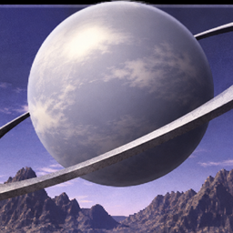
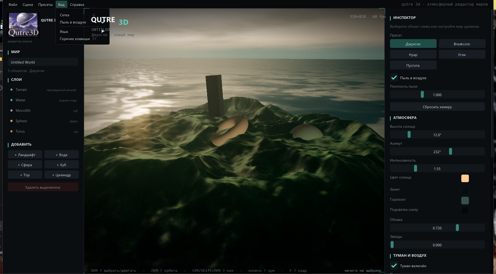
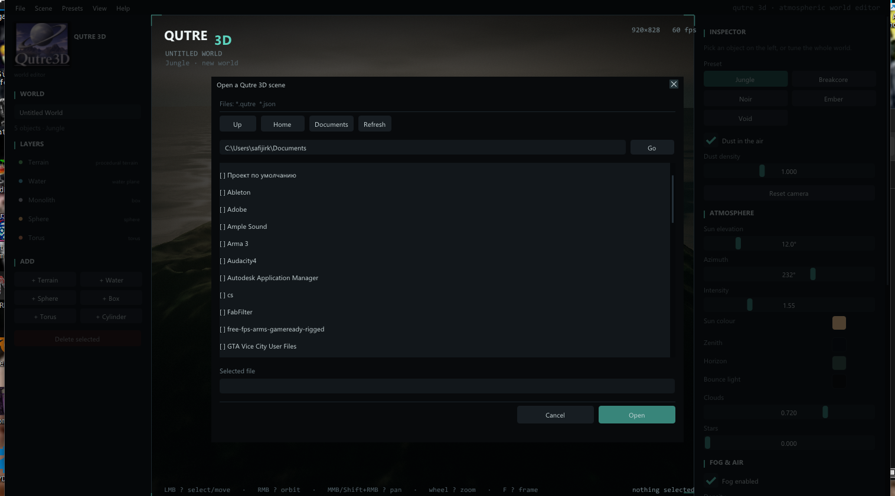
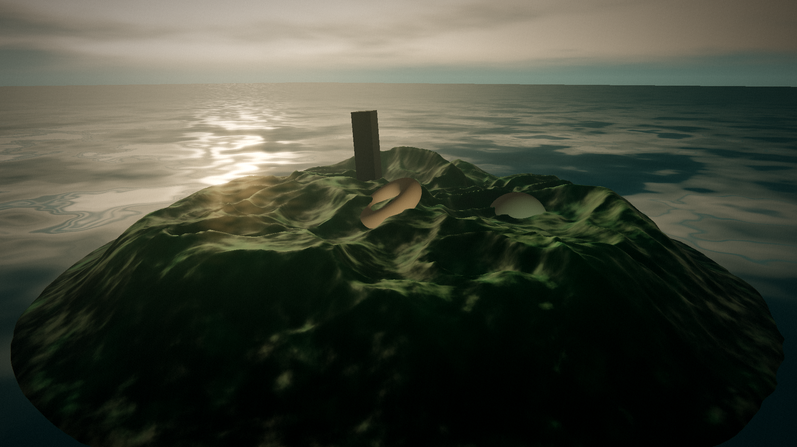
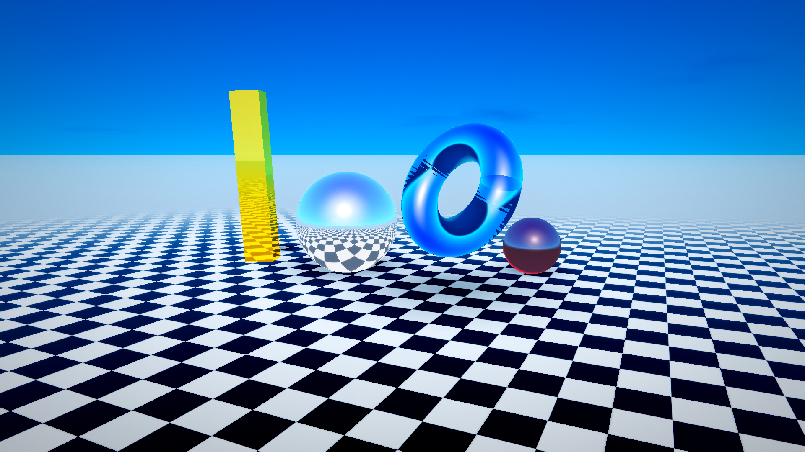
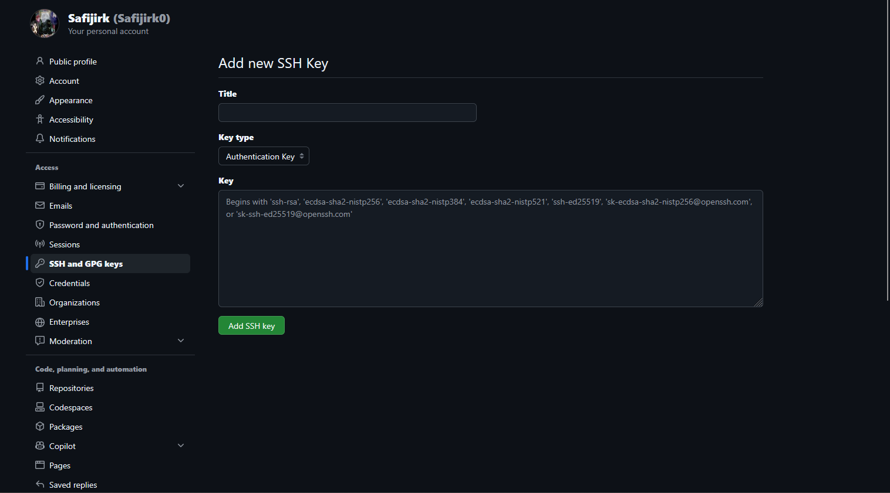

<div align="center">



# Qutre 3D

**Atmospheric 3D world editor** · **Атмосферный 3D-редактор миров**

Procedural terrain, water, fog and cinematic post-processing — a Bryce-inspired
playground for DnB, jungle and breakcore artwork.

[English](#english) · [Русский](#русский)

[](../../releases)
[](https://dotnet.microsoft.com)
[](https://www.opengl.org)
[](#downloads)
[](LICENSE)

</div>

---

## English

Qutre 3D is a compact, code-first 3D editor written in C#. It generates worlds
instead of importing them: fractal terrain, an endless ocean, volumetric-looking
fog and a film-style post chain (ACES, bloom, god rays, grain, chromatic
aberration). Scenes are plain JSON and can be edited by hand.

The interface is fully bilingual — English and Russian. The installer asks for a
language, and you can switch at any time in **View → Language**.

### Screenshots

| Russian UI | File dialog |
|---|---|
|  |  |





### Downloads

| Package | Platform | Size |
|---|---|---|
| [Qutre3D-0.2.0-win-x64-setup.exe](../../releases/latest/download/Qutre3D-0.2.0-win-x64-setup.exe) | Windows 10/11 x64 — installer | 28.5 MB |
| [Qutre3D-0.2.0-win-x64-portable.zip](../../releases/latest/download/Qutre3D-0.2.0-win-x64-portable.zip) | Windows 10/11 x64 — portable | 36.9 MB |
| [Qutre3D-0.2.0-linux-x64.tar.gz](../../releases/latest/download/Qutre3D-0.2.0-linux-x64.tar.gz) | Linux x64 | 35.8 MB |
| [Qutre3D-0.2.0-linux-arm64.tar.gz](../../releases/latest/download/Qutre3D-0.2.0-linux-arm64.tar.gz) | Linux arm64 | 33.6 MB |

All builds are self-contained: no .NET runtime needs to be installed.

### Install

**Windows**

1. Run `Qutre3D-0.2.0-win-x64-setup.exe`.
2. Choose **English** or **Русский** in the installer.
3. Optionally create a desktop shortcut, then launch Qutre 3D from the Start menu.

The portable zip needs no installation — unpack it and run `Qutre3D.exe`.

**Linux (any modern distribution)**

The installer is distro-agnostic and ships a self-contained build. It does not
use apt/dnf/pacman and does not require root for a normal user install.

```sh
tar -xzf Qutre3D-0.2.0-linux-x64.tar.gz
cd qutre3d-0.2.0-linux-x64
./install.sh            # asks for English / Русский
qutre3d                 # or launch "Qutre 3D" from the app menu
```

Useful options:

```sh
./install.sh --lang en          # skip the prompt
./install.sh --user             # ~/.local (default for normal users)
sudo ./install.sh --system      # /opt + /usr/local, all users
./install.sh --uninstall        # remove the installation
./install.sh --prefix DIR       # custom application directory
```

Installed files: application in `~/.local/share/qutre3d`, command
`~/.local/bin/qutre3d`, desktop entry, icon, `*.qutre` MIME type and an
uninstaller. If `~/.local/bin` is not on your `PATH`, the installer prints the
exact `export` line to add.

Requirements: x64 or arm64 CPU, OpenGL 3.3, glibc 2.23+ (Ubuntu 20.04+,
Debian 11+, Fedora 33+, Arch, openSUSE and derivatives).

### First steps

1. Pick a preset in **Presets** — Jungle, Breakcore, Noir, Embers or Void.
2. Orbit with the right mouse button and zoom with the wheel.
3. Tune terrain, sky, fog and post in the right panel.
4. Press `Ctrl+E` for a 1920×1080 PNG, or `Ctrl+S` to save a `.qutre` scene.

### Controls

| Action | Input |
|---|---|
| Select object | Left click in the viewport or in the Layers list |
| Move object | Left-drag on the ground; `Shift`+left-drag in screen space |
| Orbit camera | Right mouse button |
| Pan camera | Middle mouse button, or `Shift`+right-drag |
| Zoom | Mouse wheel (smoothed, one event per frame) |
| Frame selection | `F` |
| Reset camera | `Home` |
| Toggle grid | `G` |
| Delete object | `Del` |
| Skip splash | `Esc` |
| Save / Save as | `Ctrl+S` / `Ctrl+Shift+S` |
| Open / New scene | `Ctrl+O` / `Ctrl+N` |
| Export PNG 1920×1080 | `Ctrl+E` |
| Help and shortcuts | `F1` |

### Command line

Qutre 3D can render a frame without opening the editor UI:

```sh
Qutre3D --export shot.png --scene examples/jungle.qutre --lang en
```

| Option | Meaning |
|---|---|
| `--export`, `-e` | Output PNG path (always 1920×1080, splash skipped) |
| `--scene`, `-s` | Scene file to load |
| `--lang ru\|en` | Interface language for this run |
| `--help`, `-h` | Usage |
| `--version` | Version |

A positional `.qutre` path also opens that scene, so file associations work.

### Language and settings

Settings live in:

- Windows: `%APPDATA%\Qutre3D\settings.json`
- Linux: `~/.config/Qutre3D/settings.json`

```json
{
  "Language": "en",
  "LastDirectory": ""
}
```

The installer writes the initial language. If the file is missing, the app picks
Russian or English from the system locale. You can also switch languages at
runtime in **View → Language**.

### Features

- Procedural terrain built from fBm and ridged noise with domain warping,
  island masks and shore darkening; meshes are cached by parameter hash.
- Animated water, distance fog, sun and sky lighting evaluated per fragment.
- HDR pipeline with bloom, god rays, ACES tone mapping, saturation, contrast,
  tint, vignette, grain and chromatic aberration.
- Presets are plain sets of numbers — colors, sun, fog, post and terrain palette.
- Materials: albedo, emissive, roughness, metallic, opacity.
- Drag objects directly in the viewport; gizmo highlighting and a layer list.
- In-app file browser with path entry, filtering and remembered directories.
- Full English/Russian UI, bundled DejaVu fonts for guaranteed Cyrillic glyphs.
- Self-contained builds for Windows x64, Linux x64 and Linux arm64.

### Build from source

Requirements: .NET 8 SDK. Build and run:

```sh
dotnet build Qutre3D.sln -c Release
dotnet run --project src/Qutre3D -c Release
```

On Windows you can also use `start.bat`.

To rebuild all release packages (publish, zip/tar, Inno Setup installer):

```powershell
powershell -ExecutionPolicy Bypass -File installer/build-packages.ps1
```

Artifacts appear in `dist/installers`. The Windows installer requires
[Inno Setup 6](https://jrsoftware.org/isinfo.php); the script finds it in the
default installation directory.

### Project layout

```text
Qutre3D.sln
start.bat                  Windows build-and-run helper
assets/                    logo, icons, bundled fonts
docs/screenshots/          README images
examples/                  sample scenes
installer/
  windows/qutre3d.iss      Inno Setup definition (RU/EN)
  linux/install.sh         distro-agnostic installer
  build-packages.ps1       reproducible release build
src/Qutre3D/
  Program.cs               entry point, CLI, crash logging
  Core/                    scene, camera, noise, terrain, presets, JSON, i18n
  Render/                  OpenGL 3.3 shaders, meshes, framebuffers, pipeline
  UI/                      ImGui menus, panels, theme, fonts, logo texture
  App/                     window, input, settings, file dialog, ImGui backend
  Export/                  managed PNG writer
```

### Scene format

`.qutre` is JSON. Missing fields fall back to defaults, so hand-editing is safe:

```json
{
  "name": "Untitled World",
  "preset": "jungle",
  "entities": [
    {
      "name": "Terrain",
      "kind": "Terrain",
      "terrain": { "seed": 1337, "size": 170.0, "height": 26.0, "octaves": 7 }
    }
  ],
  "sky": { "sunElevation": 12.0, "sunAzimuth": 232.0, "cloudCover": 0.72 },
  "fog": { "density": 0.0058 },
  "post": { "bloom": 0.55, "godRays": 0.4 }
}
```

Vectors are `[x, y, z]`.

### Known limitations

- No undo/redo and no shadow maps (direct light plus sky ambient only).
- OBJ/glTF import is not implemented — procedural primitives only.
- Water is an infinite plane at `y = 0`; moving the water object does not tilt it.
- Transparent objects are drawn in list order, without sorting.
- The custom ImGui backend is intentionally minimal (no clipboard or callbacks).

### License

MIT — see [LICENSE](LICENSE). Bundled DejaVu fonts are covered by their own
license in [assets/fonts/LICENSE.txt](assets/fonts/LICENSE.txt).

---

## Русский

Qutre 3D — компактный 3D-редактор миров на C#, где мир не импортируют, а
генерируют: фрактальный рельеф, бесконечный океан, густой туман и киношный пост
(ACES, bloom, god rays, зерно, хроматическая аберрация). Сцены — обычный JSON,
их можно править руками.

Интерфейс полностью двуязычный. Установщик спрашивает язык, а переключить его
можно в любой момент через **Вид → Язык**.

### Скриншоты


| Английский интерфейс | Файловый диалог |
|---|---|
|  |  |


### Загрузка

| Пакет | Платформа | Размер |
|---|---|---|
| [Qutre3D-0.2.0-win-x64-setup.exe](../../releases/latest/download/Qutre3D-0.2.0-win-x64-setup.exe) | Windows 10/11 x64 — установщик | 28,5 МБ |
| [Qutre3D-0.2.0-win-x64-portable.zip](../../releases/latest/download/Qutre3D-0.2.0-win-x64-portable.zip) | Windows 10/11 x64 — портативная | 36,9 МБ |
| [Qutre3D-0.2.0-linux-x64.tar.gz](../../releases/latest/download/Qutre3D-0.2.0-linux-x64.tar.gz) | Linux x64 | 35,8 МБ |
| [Qutre3D-0.2.0-linux-arm64.tar.gz](../../releases/latest/download/Qutre3D-0.2.0-linux-arm64.tar.gz) | Linux arm64 | 33,6 МБ |

Все сборки self-contained: устанавливать .NET отдельно не нужно.

### Установка

**Windows**

1. Запустите `Qutre3D-0.2.0-win-x64-setup.exe`.
2. Выберите **English** или **Русский** в установщике.
3. При желании создайте ярлык на рабочем столе и запускайте Qutre 3D из меню «Пуск».

Портативной версии установка не нужна — распакуйте архив и запустите
`Qutre3D.exe`.

**Linux (любой современный дистрибутив)**

Установщик не зависит от дистрибутива: внутри self-contained сборка, не нужны
apt/dnf/pacman и root для обычной пользовательской установки.

```sh
tar -xzf Qutre3D-0.2.0-linux-x64.tar.gz
cd qutre3d-0.2.0-linux-x64
./install.sh            # спросит English / Русский
qutre3d                 # или запустите «Qutre 3D» из меню приложений
```

Полезные параметры:

```sh
./install.sh --lang ru          # без вопроса о языке
./install.sh --user             # ~/.local (по умолчанию для обычного пользователя)
sudo ./install.sh --system      # /opt + /usr/local, для всех пользователей
./install.sh --uninstall        # удалить установку
./install.sh --prefix DIR       # свой каталог приложения
```

Что устанавливается: приложение в `~/.local/share/qutre3d`, команда
`~/.local/bin/qutre3d`, ярлык в меню, иконка, MIME-тип для `*.qutre` и
деинсталлятор. Если `~/.local/bin` нет в `PATH`, установщик покажет готовую
строку `export`.

Требования: x64 или arm64, OpenGL 3.3, glibc 2.23+ (Ubuntu 20.04+, Debian 11+,
Fedora 33+, Arch, openSUSE и производные).

### Первые шаги

1. Выберите пресет в меню **Пресеты** — «Джунгли», «Breakcore», «Нуар»,
   «Угли» или «Пустота».
2. Вращайте камеру правой кнопкой мыши, приближайте колесом.
3. Настройте рельеф, небо, туман и пост в правой панели.
4. `Ctrl+E` — PNG 1920×1080, `Ctrl+S` — сохранить сцену `.qutre`.

### Управление

| Действие | Как |
|---|---|
| Выбрать объект | ЛКМ по объекту или по строке в «Слоях» |
| Двигать объект | ЛКМ и тянуть по земле; `Shift`+ЛКМ — в плоскости экрана |
| Орбита | Правая кнопка мыши |
| Панорама | Средняя кнопка или `Shift`+ПКМ |
| Зум | Колесо (плавно, одно событие на кадр) |
| Кадрировать | `F` |
| Сброс камеры | `Home` |
| Сетка | `G` |
| Удалить объект | `Del` |
| Пропустить заставку | `Esc` |
| Сохранить / Сохранить как | `Ctrl+S` / `Ctrl+Shift+S` |
| Открыть / Новая сцена | `Ctrl+O` / `Ctrl+N` |
| Экспорт PNG 1920×1080 | `Ctrl+E` |
| Справка и горячие клавиши | `F1` |

### Командная строка

Кадр можно отрендерить без интерфейса:

```sh
Qutre3D --export shot.png --scene examples/jungle.qutre --lang ru
```

| Параметр | Значение |
|---|---|
| `--export`, `-e` | Путь PNG (всегда 1920×1080, заставка пропускается) |
| `--scene`, `-s` | Файл сцены |
| `--lang ru\|en` | Язык интерфейса на этот запуск |
| `--help`, `-h` | Справка |
| `--version` | Версия |

Путь к `.qutre`, переданный позиционным аргументом, тоже открывает сцену —
поэтому работают ассоциации файлов.

### Язык и настройки

Настройки лежат в:

- Windows: `%APPDATA%\Qutre3D\settings.json`
- Linux: `~/.config/Qutre3D/settings.json`

```json
{
  "Language": "ru",
  "LastDirectory": ""
}
```

Установщик записывает язык первого запуска. Если файла нет, приложение выберет
русский или английский по локали системы. Переключить язык можно и во время
работы: **Вид → Язык**.

### Возможности

- Процедурный рельеф: fBm и ridged-шум с доменным искривлением, маска острова,
  затемнение берега; меши кешируются по хешу параметров.
- Анимированная вода, туман, солнечное и небесное освещение во фрагментном
  шейдере.
- HDR-конвейер: bloom, god rays, ACES, насыщенность, контраст, тонирование,
  виньетка, зерно и хроматическая аберрация.
- Пресеты — просто наборы чисел: цвета неба, солнце, туман, пост и палитра.
- Материалы: albedo, emissive, roughness, metallic, opacity.
- Перетаскивание объектов прямо во вьюпорте, подсветка гизмо, список слоёв.
- Встроенный файловый диалог с вводом пути, фильтрами и запоминанием каталога.
- Полный интерфейс RU/EN и встроенные шрифты DejaVu с гарантированной кириллицей.
- Self-contained сборки для Windows x64, Linux x64 и Linux arm64.

### Сборка из исходников

Нужен .NET 8 SDK:

```sh
dotnet build Qutre3D.sln -c Release
dotnet run --project src/Qutre3D -c Release
```

В Windows также можно запустить `start.bat`.

Пересобрать все релизные пакеты (publish, zip/tar, установщик Inno Setup):

```powershell
powershell -ExecutionPolicy Bypass -File installer/build-packages.ps1
```

Готовые файлы появятся в `dist/installers`. Для Windows-установщика нужен
[Inno Setup 6](https://jrsoftware.org/isinfo.php); скрипт ищет его в каталоге
установки по умолчанию.

### Структура проекта

```text
Qutre3D.sln
start.bat                  сборка и запуск в Windows
assets/                    логотип, иконки, встроенные шрифты
docs/screenshots/          изображения для README
examples/                  примеры сцен
installer/
  windows/qutre3d.iss      установщик Inno Setup (RU/EN)
  linux/install.sh         универсальный установщик
  build-packages.ps1       воспроизводимая сборка релиза
src/Qutre3D/
  Program.cs               вход, CLI, логирование крашей
  Core/                    сцена, камера, шум, рельеф, пресеты, JSON, локализация
  Render/                  OpenGL 3.3: шейдеры, меши, FBO, конвейер
  UI/                      ImGui: меню, панели, тема, шрифты, логотип
  App/                     окно, ввод, настройки, файловый диалог, бэкенд ImGui
  Export/                  свой PNG-экспорт
```

### Формат сцены

`.qutre` — это JSON. Отсутствующие поля заменяются значениями по умолчанию,
поэтому файл можно править руками:

```json
{
  "name": "Безымянный мир",
  "preset": "jungle",
  "entities": [
    {
      "name": "Ландшафт",
      "kind": "Terrain",
      "terrain": { "seed": 1337, "size": 170.0, "height": 26.0, "octaves": 7 }
    }
  ],
  "sky": { "sunElevation": 12.0, "sunAzimuth": 232.0, "cloudCover": 0.72 },
  "fog": { "density": 0.0058 },
  "post": { "bloom": 0.55, "godRays": 0.4 }
}
```

Векторы записываются как `[x, y, z]`.

### Известные ограничения

- Нет undo/redo и теней (только прямой свет и небесная подсветка).
- OBJ/glTF не импортируются — только процедурные примитивы.
- Вода — бесконечная плоскость на `y = 0`; перемещение объекта её не наклоняет.
- Прозрачные объекты рисуются в порядке списка, без сортировки.
- Собственный бэкенд ImGui намеренно минимальный (без буфера обмена и колбэков).

### Лицензия

MIT — см. [LICENSE](LICENSE). Встроенные шрифты DejaVu распространяются по
своей лицензии: [assets/fonts/LICENSE.txt](assets/fonts/LICENSE.txt).

---

<div align="center">

Made with C#, OpenTK and ImGui.NET.

**[⬆ Back to top / Наверх](#qutre-3d)**

</div>
